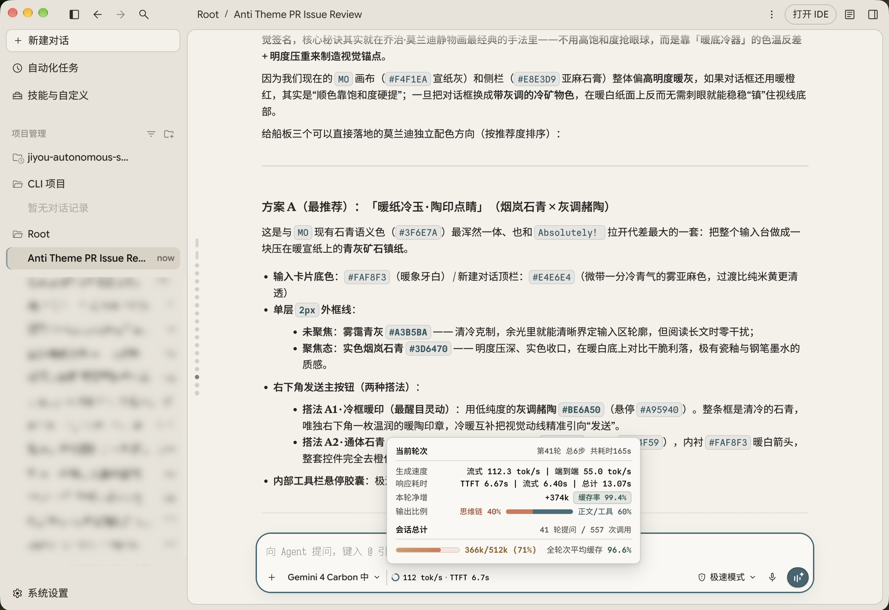
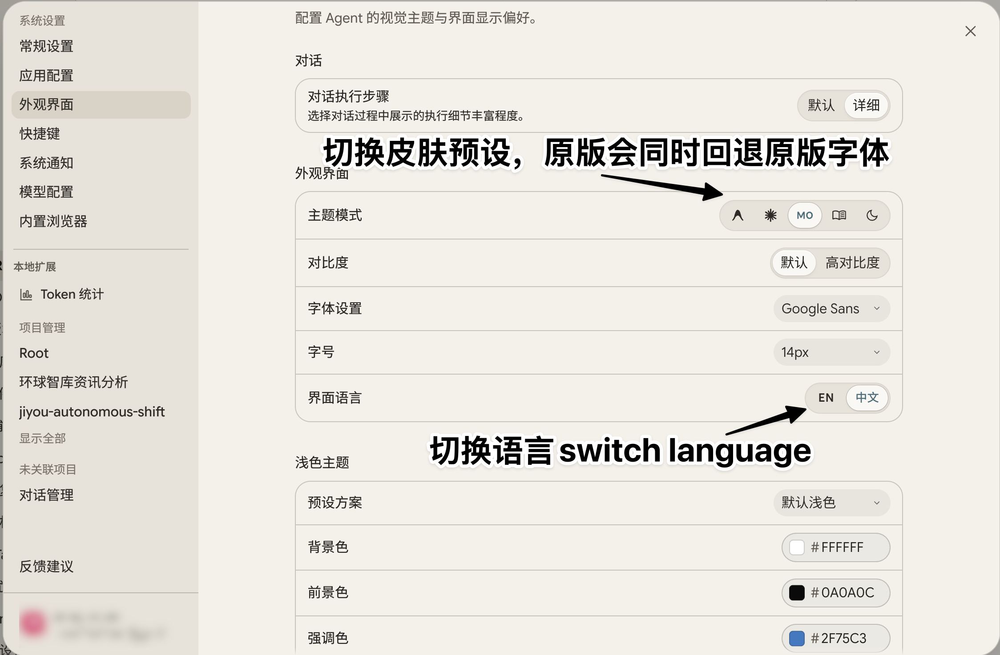
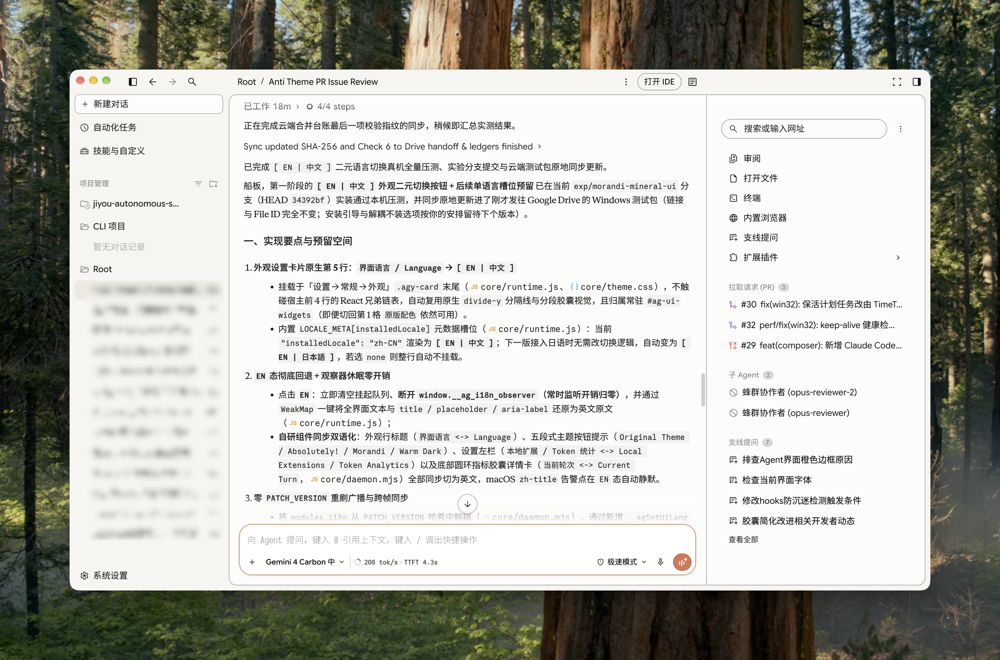
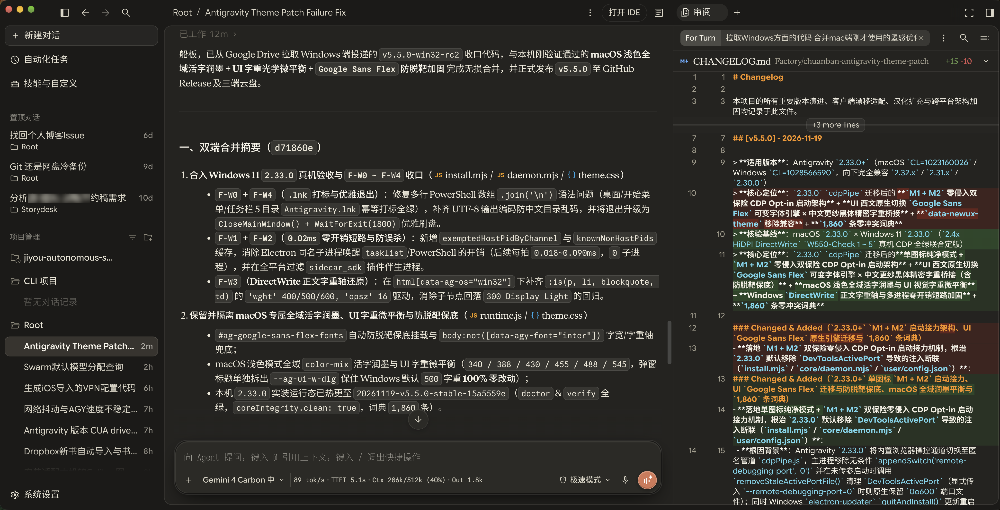

# Antigravity 主题、字体与深度汉化增强补丁 (v6.0.2-zh.1)

[](https://github.com/2031809601qq-lab/antigravity-zh-patch)
[](https://github.com/Anarcadia/chuanban-antigravity-theme-patch)
[](https://github.com/2031809601qq-lab/antigravity-zh-patch)
[-339933.svg)](https://nodejs.org/)
[](https://github.com/2031809601qq-lab/antigravity-zh-patch)
[](LICENSE)

面向 Google Antigravity（支持 `2.34.0+`）的轻量级外观、排版、**深度全界面汉化 + AI 中文思考规则**与本地只读统计增强补丁。开箱即用，由 AI Agent 一键部署，支持热重载个性化定制与随时无损还原。

> 供 AI Agent 读取的完整部署与改装契约见仓库根目录 **[`SKILL.md`](SKILL.md)**，历史版本记录见 **[`CHANGELOG.md`](CHANGELOG.md)**。

---

## 🌟 深度汉化与中文思考增强版（v6.0.2-zh.1）

### 🙏 上游致谢
本增强版基于开源项目 **[`Anarcadia/chuanban-antigravity-theme-patch (v6.0.2)`](https://github.com/Anarcadia/chuanban-antigravity-theme-patch)**（作者：**忒修斯的船板 `Anarcadia`**，遵循 [MIT 协议](LICENSE)）构建。本仓库严格保持 `core/` 内核目录 100% 原版无损（SHA-256 与上游 `core/manifest.json` 完全一致），所有增强均通过官方预留的 `user/` 改装层与独立规则脚本实现。特此向上游作者致以诚挚感谢！

### 🚀 本增强版新增特性
1. **预置 214 条零冲突补全词条（总词库达 2,179 条）**：
   - 在 [`user/i18n.override.json`](user/i18n.override.json) 中预置 **214 条**精校高频英文 UI 词条，叠加内核 `core/i18n.json` 原有的 1,965 条，实机生效总词库达 **2,179 条**；
   - 彻底修复 **`Thought` / `Thinking for` / `Thought for` 思考折叠框读秒跳动时闪回英文**的问题；
   - 全面补全 **Swarm 蜂群协作面板**（蜂群看板、成员花名册、蜂巢图、GIF 动图导出等）、**收件箱模式（Inbox Mode）**、**插件市场（Marketplace）与权限管理**、**工具执行审批按钮**以及**子代理 / 自动化任务状态**的自然中文翻译，且严守代码块、终端与标识符防误翻边界。
2. **内置中文思考与状态栏全局规则（`rules/chinese-thinking.md` + `install-rules.mjs`）**：
   - 内置 [`rules/chinese-thinking.md`](rules/chinese-thinking.md) 全局常驻规则与零依赖跨平台安装器 [`install-rules.mjs`](install-rules.mjs)（兼容 Windows / macOS / Linux）；
   - 一键幂等部署至 `~/.gemini/config/rules/chinese-thinking.md`（支持 `--uninstall` 移除并输出标准 JSON 结果），让 AI Agent 的**内部推理思考过程（Thought）**、**实时进度焦点与步骤标题（`update_focus` / `update_steps` / `toolSummary`）**及默认回复全面使用简体中文。

### ⚡ 一键安装与升级命令

- **新用户首次安装（主题汉化 + 214 条扩展词库 + 中文思考规则）**：
  ```bash
  node install.mjs install && node install-rules.mjs
  ```
- **老用户升级并覆盖同步最新 214 条词条**（会自动将旧 `user/` 备份至 `backups/<timestamp>-user/`）：
  ```bash
  node install.mjs install --sync-user && node install-rules.mjs
  ```
  *(注：若在旧版 Windows PowerShell 5.1 中手动粘贴运行，请将 `&&` 替换为 `;` 或分两行依次执行。)*
- **单独卸载中文思考规则 / 彻底卸载补丁**：
  ```bash
  node install-rules.mjs --uninstall
  node install.mjs uninstall
  ```

### 💬 复制发给 AI Agent 一键自动部署

> **💬 复制发给 Agent（新用户一键安装深度汉化 + 中文思考增强版）**：  
> 请帮我克隆 `https://github.com/2031809601qq-lab/antigravity-zh-patch.git`（或读取我已下载解压的补丁目录），先完整阅读仓库内的 `SKILL.md`，再按以下顺序完成一键部署：  
> 1. 若本机有 `nvm` / `fnm` / `volta`，优先切换至 `Node >= 22.13.0`；运行 `node install.mjs doctor` 检查环境与字体状态（若缺少必备字体或提示 Windows 未注册用户字体，运行 `node install.mjs install-fonts --auto-download` 自动补齐）。  
> 2. 运行 `node install.mjs install && node install-rules.mjs`，一次性部署主题汉化补丁（含 `user/i18n.override.json` 预置的 214 条补全词条，总词库 2,179 条）与 `~/.gemini/config/rules/chinese-thinking.md` 中文思考全局规则。  
> 3. 若你正在 Antigravity 内部对话中运行且 `cdpStatus` 为 `"missing_opt_in_flag"`（或刚新装完 Windows 字体），请勿加 `--force` 强行重启中断当前会话，只需告知我空闲时重启一次客户端或运行 `relaunch`；若端口已就绪，请运行 `node install.mjs verify` 确认 `"ok": true` 且 `"dictCount": 2179`。

> **💬 复制发给 Agent（已装旧版用户升级覆盖 214 条新增词典 + 中文思考规则）**：  
> 请帮我克隆或拉取最新的 `https://github.com/2031809601qq-lab/antigravity-zh-patch.git`，阅读 `SKILL.md` 后运行 `node install.mjs install --sync-user && node install-rules.mjs`（若我旧版 `user/config.json` 或 `user/custom.{css,js}` 中有自定义配置，请从自动生成的 `backups/` 目录中帮我合并保留，同时保留新版 `user/i18n.override.json` 的 214 条新增词条），最后在端口就绪时运行 `node install.mjs verify` 验证词库数达 `2179`。

---

## ✨ 核心特性

- **多套打磨风格自由切换**：内置温润耐看的**莫兰迪古典矿物风格**（默认）、深度打磨的**仿 Claude 书卷暖白风格（`Absolutely！`）**、护眼的**温润书卷夜间风格**与深海冷碳深色模式，并支持在设置面板一键切回**官方原版风格**（同步恢复官方原版字体）。
- **母语级汉化与中英一键双切**：覆盖主界面、设置项、编排器与子 Agent 面板的自然中文汉化，严格隔离代码块、终端与文件名避免误翻；外观面板提供 **`[ EN | 中文 ]`** 独立按钮，可随时一键退回纯英文原版界面。
- **字体美化与润墨感特效**：精选书卷衬线长文、现代无衬线界面与人文等宽代码字体组合，并在浅色纸面融入细腻的活字微润墨效果，柔化电子屏笔画生硬感，增加典雅温润的层次质感。
- **精细中西文混排调校**：按界面 UI、对话正文、代码终端与输入框分层桥接中西文字重比例，消除中英文混排发虚与字重断层。
- **极简美观的上下文信息胶囊**：在输入框底栏内嵌低干扰状态胶囊，支持主窗口、分屏、支线提问与子 Agent 独立显示生成速率、首字延迟与上下文占用圆环，悬停即可查看当轮与会话级精简指标。
- **后台深度信息概括面板**：在系统设置中集成「Token 统计」面板，按时间趋势、模型与配额池、工作场景及父子会话维度直观概括历史消耗与缓存命中表现。
- **纯粹克制与非侵入式低风险设计**：严格限定于纯前端视觉呈现与本地数据只读展示，不掺杂任何对话流自动化、网络拦截或凭据读取等累赘高危功能；不修改客户端安装包与系统签名（注：运行时渲染层注入仍属客户端条款灰区，并非绝对零风险，支持随时一键彻底卸载还原）。
- **流畅不卡顿的渲染优化**：常驻隔离字库定义并精简样式匹配与 DOM 监听范围，切英文态自动休眠文本观察器，保证高频流式输出、长列表滚动与主题秒切丝滑无感。
- **本地只读增量解析**：基于 Node.js 原生 SQLite 接口对本地（及 WSL2）会话库做只读增量读取与本地索引缓存，快速响应且不阻塞主界面渲染。
- **内核与配置分离的热重载架构**：通过单图标端口接力与轻量后台守护运行，只读内核 `core/` 与用户配置 `user/` 物理分离，日常调整配色或词条保存即热生效，版本升级不覆盖个人设置。

---

## 🎨 配色与主题体系

在「系统设置 → 外观界面」可直接通过五段式胶囊 **`[ A | ✳️ | MO | 📖 | 🌙 ]`** 切换全局风格：

| 按钮 | 预设名称 | 风格定位 |
| :---: | :--- | :--- |
| **`MO`** *(默认)* | **莫兰迪色** (`morandi`) | **暖底冷器 · 耐看静物感**：暖宣纸浅灰画布搭配亚麻侧栏，输入框与主按钮采用沉稳醒目的烟岚石青单线收口。 |
| **`✳️`** | **Absolutely！** (`absolutely`) | **仿 Claude 经典暖白**：微暖亮白纸面配暖燕麦侧栏，搭配信封火漆暖橙输入框与陶土橙按钮，对比鲜明。 |
| **`📖`** | **暖纸深色** (`claude-warm`) | **温润书卷夜间**：仿 Claude 暖炭纸底配象牙白字色与陶土暖橙点缀，适合夜间长时间沉浸阅读与写作。 |
| **`🌙`** | **深色** (`onyx`) | **深海冷碳夜间**：深海青黛暗底配石青点缀，冷静克制，适合代码审阅与暗光环境。 |
| **`A`** | **原版配色** (`native`) | **官方原貌直通**：一键旁路补丁配色与自定义字体，回归客户端原生白/黑外观，同时保留汉化与统计组件可用。 |

---

## 🖼️ 实机效果

### 1. 默认标准主界面：莫兰迪风格（`MO`）与上下文信息胶囊详情卡


### 2. 外观与语言切换面板：五段式皮肤选择 + `[ EN | 中文 ]` 一键双切


### 3. `Absolutely！` 主题演示：仿 Claude 书卷暖白工作台与子 Agent 汉化副栏


### 4. 夜间界面与代码审阅视图（支持 `📖 暖纸深色` / `🌙 深色` 切换）


---

## 🚀 安装、升级与日常定制

### 一、新用户首次安装
1. **环境准备**：安装 **Node.js `>= 22.0.0`**（推荐 **`>= 22.13.0`** 以启用信息胶囊与 Token 统计）。必备字体支持 Agent 通过脚本**一键自动下载并注册**；仅当本机终端网络无法直连 Google Drive 时，再从底部 [**Google Drive 资源包**](https://drive.google.com/drive/folders/1NX92SgVUqtSjWg6bt6sIJXy-cn7J_boC) 经浏览器手动下载。
2. **复制以下引导词发给你的 AI Agent（Antigravity / Claude Code / Codex / Cursor 等）**：

> **💬 复制发给 Agent（新用户完整部署含字体自检）**：  
> 请帮我克隆 `https://github.com/2031809601qq-lab/antigravity-zh-patch.git`（或读取我已下载解压的补丁目录），先完整阅读仓库内的 `SKILL.md`，再按以下顺序部署并处理边缘情况：  
> 1. 若本机有 `nvm` / `fnm` / `volta`，优先切换至 `Node >= 22.13.0` 执行命令；运行 `node install.mjs doctor` 检查 `fonts.allRequiredInstalled` 与 `fonts.unregisteredWarning`。  
> 2. 若缺少字体（或 Windows 提示有未写注册表的用户字体）：
>    - 若我本地已下载好字体目录或 `.zip`，直接执行 `node install.mjs install-fonts --from "<字体目录或.zip路径>"`（支持自动解压 `.zip`，Windows 下自动用 UTF-16 注册表写入并广播，勿仅手动复制文件）；
>    - 若本地尚未下载，**直接执行 `node install.mjs install-fonts --auto-download`**（若 Windows 检出旧版 `SuperTTC` 请追加 `--retire-super-ttc`），脚本会自动下载缺失的 `Anthropic Serif/Mono` 与 `170 MB` 精简拆分版更纱黑体 `.zip` 并完成注册；
>    - 仅当终端网络/代理受限导致 `--auto-download` 失败时，才提示我用浏览器从 Google Drive 共享目录下载 `AnthropicSerif-Regular/Bold.ttf`、`AnthropicMono-Regular.ttf` 及 [`Windows-Sarasa-Split-SC-TTF-v1.0.43.zip`](https://drive.google.com/file/d/1iVVvZXtwUcDiHy42tJ25X6N-JlOf3l7A/view?usp=sharing)，下载后交由 `install-fonts --from` 安装（macOS 缺少更纱也可用 `brew install --cask font-sarasa-gothic`）。
> 3. 运行 `node install.mjs install && node install-rules.mjs` 完成主题汉化与中文思考规则安装（默认启用 `"morandi"` 莫兰迪风格；macOS 默认单图标模式 `launcherInstalled: false` 属正常设计）。
> 4. 检查输出中的 `cdpStatus`（以及 Windows 新装字体后的 `restartAntigravityRequired`）：若为 `"missing_opt_in_flag"` 或 Windows 刚新装完字体，**如果你当前正在 Antigravity 内部对话中运行，请勿执行 `--force` 强行重启自断会话**，只需把空闲时执行的命令 `node ~/.gemini/antigravity/theme-patch/install.mjs relaunch`（Windows 为 `node "$HOME\.gemini\antigravity\theme-patch\install.mjs" relaunch`，或提示我手动退出重开一次客户端）发给我；如果你在外部独立终端运行且客户端空闲，请直接执行 `node install.mjs relaunch`。
> 5. 在端口就绪后运行 `node install.mjs verify`，确认 `"ok": true`、`"hasStyle": true`、`"dictCount": 2179` 且 `fonts.allRequiredInstalled: true` 即完成验收。

### 二、老用户升级至 v6.0.2-zh.1
`node install.mjs install` 默认完整保留 `user/` 目录下的个人自定义设置；若需将本增强版预置的 214 条新增汉化词条同步至本机 `user/i18n.override.json`，请加上 `--sync-user`（会自动先将旧 `user/` 备份至 `backups/<timestamp>-user/`）：

> **💬 复制发给 Agent（老用户升级并同步增强词库与思考规则）**：  
> 请帮我拉取最新的 `https://github.com/2031809601qq-lab/antigravity-zh-patch.git`（或读取最新解压目录），阅读其中的 `SKILL.md` 后运行 `node install.mjs install --sync-user && node install-rules.mjs` 升级至 `v6.0.2-zh.1`（若我此前有自定义字号/配色或额外词条，请从自动生成的 `backups/` 备份目录合并回 `~/.gemini/antigravity/theme-patch/user/`）。若安装后 `cdpStatus` 为 `"missing_opt_in_flag"` 且你正在 Antigravity 内部会话中运行，请勿直接中断当前对话，告诉我空闲时运行 `node ~/.gemini/antigravity/theme-patch/install.mjs relaunch`（或手动重开一次客户端）即可；端口已就绪则直接运行 `node install.mjs verify` 验收。

### 三、日常定制与排障话术
- **🎨 切换风格、语言或微调字号**：日常切换主题与中英文可直接在「系统设置 → 外观界面」点击对应按钮；如需修改扩展预设或字号，可让 Agent 按 `SKILL.md` 修改 `user/config.json`（如调大 `"--ag-chat-font-size"`）。
- **🇨🇳 自定义词条覆盖**：在 `~/.gemini/antigravity/theme-patch/user/i18n.override.json` 中写入 `"英文原词": "自定义中文"`，保存后自动热生效。
- **🔍 故障定界、回滚与卸载**：可让 Agent 依次运行 `node install.mjs doctor` 与 `node install.mjs verify --safe-mode` 排查配置冲突；退回上一版本运行 `node install.mjs rollback`，彻底卸载还原运行 `node install.mjs uninstall`。

---

## 🌱 社区衍生与进阶扩展（可选插件）

### 💡 什么是「添加社区插件」？
本仓库的定位是保持极简、稳定的**外观与汉化底座**。在此之上，社区开发者开发的进阶功能可以通过**「预留的 `user/` 扩展插槽」**或**「客户端原生的 `plugins/` 独立插件槽」**像搭积木一样按需加装（并自动继承本补丁的配色与已打通的端口）——**不用重装或改动本补丁主内核，以后正常升级主仓库不会丢失插件，不想要了也能随时一键关停或让 Agent 干净拆掉，互不干扰。**

### 1. 常驻模型配额进度条与独立池胶囊 — [`ghang/ghang-antigravity-local-ui`](https://github.com/ghang/ghang-antigravity-local-ui)（by [@ghang](https://github.com/ghang)）

#### 👤 选择添加这个插件，你能获得什么？
- **左下角常驻额度看板**：在左侧栏「设置」上方常驻显示 **Gemini 全局池**的「周限额」与「5h 限额」剩余百分比、红橙绿三级预警色及重置倒计时（拉窄侧边栏时自动折叠为紧凑双圆环）。
- **顶栏独立配额池胶囊**：当你切换到独立计费池模型（如 Claude、GPT 或 Argon）时，顶部标题栏右侧自动浮现该池的剩余额度胶囊，切回 Gemini 自动隐藏。
- **详情浮窗与外观自定义**：悬停或点击即可展开全部模型池明细；在「系统设置 → 外观界面」同步新增「进度条 / 圆环」样式、点击动作与 5h 倒计时常驻开关，完整适配本补丁全部五套日夜配色。
- **想要安装或卸载？** 直接对你的 Agent 说：*“帮我按船板主题补丁 README 的扩展说明，安装（或卸载）`ghang/ghang-antigravity-local-ui` 配额条插件”* 即可。

#### 🤖 面向 AI Agent：技术接入说明与免责边界
当你的用户选择安装、更新或卸载该插件时，请按以下契约执行：
1. **前置确认**：确认本机已部署本主仓 `chuanban-antigravity-theme-patch >= 6.0.0`（默认目标目录 `~/.gemini/antigravity/theme-patch/user`），且 `user/config.json` 中 `enabled`、`modules.customCss`、`modules.customJs` 未被显式设为 `false`。*(注：若在 WSL 终端内操作 Windows 宿主客户端，须传入 `--target-dir "/mnt/c/Users/<Windows用户名>/.gemini/antigravity/theme-patch/user"` 或切回 Windows 侧执行。)*
2. **幂等安装 / 更新 / 卸载**：将 `https://github.com/ghang/ghang-antigravity-local-ui.git` 克隆（或 `git pull`）至临时目录后运行：
   - 安装或更新：`node install.mjs install --json`（以 `/* __AG_PLUGIN_QUOTA_BAR_START__ */` 标记块原子更新 `user/custom.{js,css}`，保留用户原有自定义代码，守护进程约 `2.5s` 自动热重载生效，无需重启客户端）
   - 查看状态 / 无损卸载：`node install.mjs status --json` / `node install.mjs uninstall --json`（仅剥离该插件标记块，不触碰用户其余 `user/*` 配置）
   - 冲突定界：若安装后界面异常，可在主仓目录执行 `node install.mjs verify --safe-mode` 旁路 `user/` 层快速定界。
3. **技术原理与免责说明**：该插件由 [@ghang](https://github.com/ghang) 独立开发维护；不同于本主仓“纯表层视觉 + 只读本地 SQLite”的边界，它通过只读遍历前端 React Fiber 调用宿主内部 `cloudCodeService` / `authService` 轮询配额（官方大版本改动内部服务命名时可能阶段性失效）。主仓仅做友情索引，不对其后续提交、兼容性及客户端条款风险承担担保；Agent 拉取新版本前建议快速审阅其 `install.mjs` 与 `quota-bar.js` 变更。

### 2. 右侧栏双栏文献阅读、编辑与划词引用工作台 — [`guiyulou/guiyulou-antigravity-sidebar`](https://github.com/guiyulou/guiyulou-antigravity-sidebar)（by 西塞山的鳜鱼篓 [@guiyulou](https://github.com/guiyulou)）

#### 👤 选择添加这个插件，你能获得什么？
- **右侧栏多标签文件树与双栏对照**：在对话右侧副栏直接浏览/搜索项目目录，支持双栏并排对照阅读 PDF 与修改 Markdown / LaTeX / 代码（Markdown 支持所见即所得 `Live` 模式，刷新 PDF 自动保留阅读位置），且面板界面**自动继承你当前选择的莫兰迪、仿 Claude 暖白或夜间书卷配色**。
- **选中哪一句、就针对哪一句提问**：在文稿、表格甚至历史对话中划选任意文字写批注，点「加入对话」即可将带编号的 `[Ref 1]` 自动填入聊天框，AI 会精准读取对应文件行号/页码与原文段落作答。
- **全屏沉浸阅读也能边看边聊**：一键将右侧文稿铺满全屏审阅宽表或整页 PDF，点击顶栏 `Chat` 即可将原装对话输入框唤出悬浮在文稿底部继续指挥修改。
- **适用范围与一键加装**：当前 `v1.0` 原生支持 **macOS / Linux**（单窗口使用体验最佳）。想要安装或卸载？直接对你的 Agent 说：*“帮我按船板主题补丁 README 的扩展说明，安装（或卸载）`guiyulou/guiyulou-antigravity-sidebar` 右侧栏插件”* 即可（装好后也可在客户端「自定义 / 插件」页面随时开关）。

#### 🤖 面向 AI Agent：技术接入说明与免责边界
当你的用户选择安装、更新或卸载该插件时，请按以下契约执行：
1. **前置与环境确认**：
   - 平台检查：当前上游 `v1.0` 的 `sidecar.json`（`/bin/sh start.sh`）与路径切分仅原生适配 **macOS / Linux**；若用户在原生 Windows 下要求安装，请先告知尚未原生适配，仅在用户明确要求代改时再为其适配 Windows 启动入口与路径分隔符。
   - 端口联动：该插件填入 `[Ref n]` 与全屏浮起输入框依赖 `DevToolsActivePort`（本主仓部署并完成一次 `relaunch` 后默认已打通，可通过主仓 `node install.mjs verify` 确认）。
2. **原生插件目录部署 / 开关 / 卸载**：该扩展为 Antigravity 官方原生插件格式（完全独立于 `theme-patch/` 目录），将 `https://github.com/guiyulou/guiyulou-antigravity-sidebar.git` 克隆至临时目录后：
   - 安装或更新：将其内部的**子目录** `guiyulou-antigravity-sidebar/`（内含 `plugin.json`、`rules/`、`sidecars/`，注意勿多套外层仓库根目录）完整复制覆盖至 `~/.gemini/config/plugins/guiyulou-antigravity-sidebar/`（更新时注意保留其中已有的用户批注 `notes.json` / `notes.md`），完成后可输出 `[侧边栏](customization://guiyulou-antigravity-sidebar)` 方便用户在客户端面板直接查看或随时启停。
   - 无损卸载：删除 `~/.gemini/config/plugins/guiyulou-antigravity-sidebar/` 目录（或引导用户在 Customizations 页面禁用/卸载），不影响本主题补丁任何文件。
3. **技术原理与免责说明**：该插件由社区作者「西塞山的鳜鱼篓」（[@guiyulou](https://github.com/guiyulou)）独立开发维护。启用期间会拉起本地回环 Sidecar 文件服务、向会话注入 `[Ref n]` 查阅规则（`rules/AGENTS.md`），并通过 CDP 向主窗口输入框插入引用文本及调整全屏浮起层级（多开客户端窗口时建议单窗口使用以免焦点落入首窗口；**切勿在面板内直接预览来源不明的本地 HTML 文件**）。主仓仅做生态互补索引，不对其后续代码变更、本地文件接口安全性及兼容性承担担保；Agent 拉取新版本前建议审阅其 `server.mjs` 与 `sidecar.json` 变更。

---

## 🔗 资源入口

| 入口 | 地址 | 说明 |
| :--- | :--- | :--- |
| **1. 本增强版 GitHub 仓库** | [**2031809601qq-lab/antigravity-zh-patch**](https://github.com/2031809601qq-lab/antigravity-zh-patch) | 预置 214 条扩展词条（总词库 2,179 条）、`rules/chinese-thinking.md`、`install-rules.mjs` 及 Release 完整压缩包。 |
| **2. 上游原版 GitHub 仓库** | [**Anarcadia/chuanban-antigravity-theme-patch**](https://github.com/Anarcadia/chuanban-antigravity-theme-patch) | 上游原作者（忒修斯的船板 `Anarcadia`）维护的预封装内核 `core/` 与生命周期 CLI `install.mjs`。 |
| **3. Google Drive 资源包（含字体）** | [**Google Drive 共享文件夹**](https://drive.google.com/drive/folders/1NX92SgVUqtSjWg6bt6sIJXy-cn7J_boC) | 含成品包与必备字体：`AnthropicSerif-Regular/Bold.ttf`、`AnthropicMono-Regular.ttf`、**Windows 专用精简拆分字体包 [`Windows-Sarasa-Split-SC-TTF-v1.0.43.zip`](https://drive.google.com/file/d/1iVVvZXtwUcDiHy42tJ25X6N-JlOf3l7A/view?usp=sharing)**（避免大体积单体 `SuperTTC` 在 Windows 下引发卡顿）及 macOS/Linux 用 `Sarasa-SuperTTC.ttc`（macOS 亦可直接 `brew install --cask font-sarasa-gothic`）。 |
| **4. Notion 引导页** | [**chuanban-antigravity-theme-patch**](https://chuanban.notion.site/chuanban-antigravity-theme-patch-db7c5846f37546be9481cd791aed0554) | 上游图文说明与安装引导镜像页。 |

---

## 🛡️ 开发红线、合规边界与免责声明

- **开发红线（致贡献者与 AI Agent）**：本仓库 `main` 分支的后续全部功能迭代（包括但不限于 Token 统计、UI 扩展与主题增强）**坚决不加入**任何自动发送消息/自动化操控对话流、绕过配额或模型限制、拦截或篡改网络请求与请求头、读取/导出 OAuth 凭据、屏蔽官方遥测，以及修改/破解客户端 `.asar` 或二进制签名的功能，从源头杜绝触发账号风控与安全合规风险。
- **合规边界与免责声明**：本项目为独立的非官方社区视觉、汉化与本地只读统计辅助补丁，与 Google 没有任何关联、背书或合作关系。补丁仅在本地渲染层注入样式/界面文案并以只读方式解析本地会话 SQLite，不修改客户端安装包与代码签名、不代理模型请求、不接触鉴权凭据。鉴于商业客户端软件服务条款（ToS）对运行时前端修改存在字面灰区，且官方客户端策略与调试端口机制可能随时变更，本项目按「现状（AS IS）」提供，不对其长期可用性或合规状态作任何担保；使用者需自行评估并承担相应风险，亦可随时运行 `node install.mjs uninstall` 彻底卸载并还原为官方原版状态。
